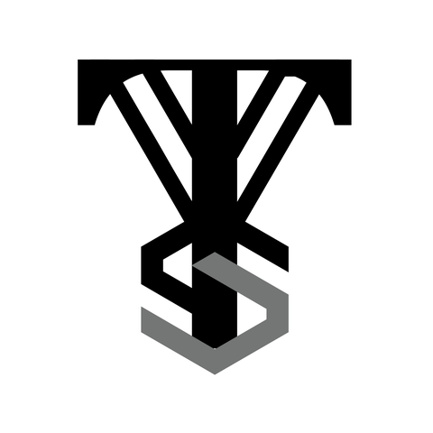
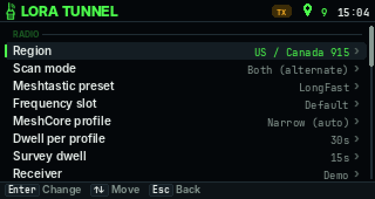
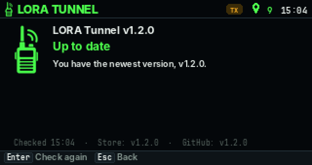
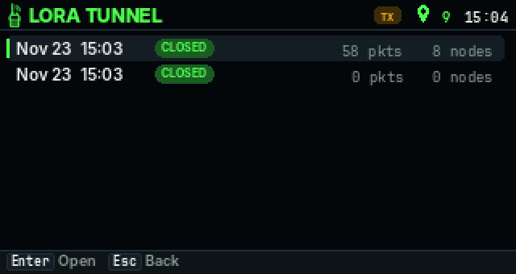
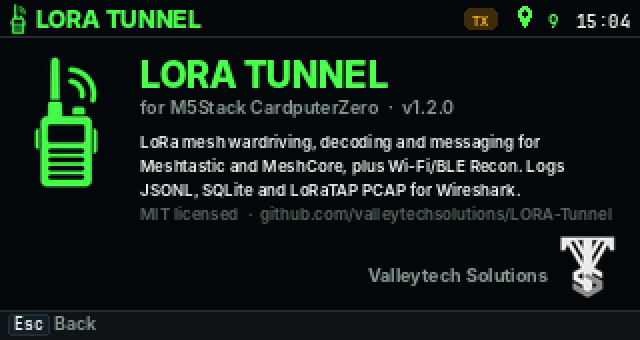

<p align="center">
  
</p>

<h1 align="center">LORA Tunnel for M5Stack CardputerZero</h1>

<p align="center">
  <b>Now in the CardputerZero App Store: open Store, press 5 and enter share code <code>LORA</code></b><br>
  All-in-one LoRa, Wi-Fi and Bluetooth wardriver · MIT open source
</p>

<p align="center">
  <a href="https://valleytechsolutions.tech"></a><br>
  <sub>Made by Valleytech Solutions</sub>
</p>

LORA Tunnel turns the **M5Stack CardputerZero** and the **Cap LoRa-1262 (U214)** into an all-in-one LoRa, Wi-Fi and Bluetooth wardriver. One press of Space and it:

- listens for **Meshtastic and MeshCore** traffic, decrypts the channels you hold keys for, decodes every common app type (text, positions, node info, all telemetry, traceroutes, neighbor lists, map reports, waypoints and more), and maps every node it hears;
- logs **every Wi-Fi network and BLE device** around you with GPS into a **WiGLE-ready CSV**;
- runs **Recon**, which flags surveillance gear and trackers (ALPR and Flock cameras, Axon body cameras, Ring and other cameras, AirTags, Remote ID drones and more), warns you, and tells you if something seems to be following you.

It can also chat on Meshtastic and MeshCore channels. Every LoRa frame is saved with its raw bytes, exact radio settings and your GPS position.

It runs as an APPLaunch app from the CardputerZero App Store, or as a `.deb` you install yourself. It's the CardputerZero member of the LORA Tunnel family, next to the ESP32 firmware for the Cardputer ADV and Heltec V4 in this repository.

| Wardrive (LoRa + Wi-Fi + BLE) | Recon | Messages |
| --- | --- | --- |
|  |  |  |
| **Mesh node** | **Traceroute** | **Settings** |
|  |  |  |
| **Home** | **Recon device** | **Signal finder** |
|  |  |  |
| **Nodes** | **Packet detail** | **Write a message** |
|  |  |  |
| **Check for updates** | **Sessions** | **About** |
|  |  |  |

The screenshots are rendered from the app's own drawing code with its synthetic demo receiver and scanners. They aren't photos of real traffic or real devices.

## What it does

- **Same channel plan as Kismet's LoRaPipe.** All nine Meshtastic presets at the default slot for each region, explicit slots, and Kismet's MeshCore regional presets. Channel IDs use Kismet's names (`meshtastic-US-LONG_FAST`, `meshcore-US-NARROW`). Frequencies are tested against Kismet's channel reference.
- **Four scan modes.** Meshtastic only, MeshCore only, both alternating, or **Survey**, which hops every preset and MeshCore profile in your region so you can find what the local community actually uses. Dwell time is adjustable from 5 to 600 seconds. You can hop by hand with ← →.
- **Meshtastic decoding.** On the default channel of every preset and any private channels you add (AES-128 or AES-256):
  - text, plus detection-sensor, alert, range-test and store-and-forward messages;
  - positions with satellites, speed and precision;
  - node info with hardware model, role and public key;
  - every telemetry kind: device, environment (temperature, humidity, pressure, wind, rain and more), air quality, power, local mesh stats, health and host;
  - traceroutes with per-hop SNR both ways, neighbor lists, routing ACKs and errors, map reports (firmware version, region, preset), waypoints and paxcounter.

  Every other port is named, and its raw payload is kept.
- **MeshCore decoding.**
  - Adverts with Ed25519 signature checks.
  - Public, hashtag and private group text, including signed and CLI messages, and group data.
  - Traces with per-hop SNR, node discovery requests and responses, anonymous requests with the sender's public key, ACKs and multipart packets.
  - Direct messages are end-to-end encrypted. Their sender and recipient hashes are logged, but their content can't be read.
- **Every frame is saved**, even ones it can't decode.
- **Live views.** Packet counts, node count, decode rate, last RSSI and a two-minute activity graph colored by signal. There are sortable node lists, per-node details with distance and bearing to a node's claimed position, a feed of heard channel messages, and a per-packet inspector with a hex dump.
- **Wi-Fi and BLE wardriving.** While LoRa capture runs, the app also scans Wi-Fi (2.4, 5 and 6 GHz, through NetworkManager or `iw`) and Bluetooth LE (through BlueZ). It logs every network and device, with a GPS fix no more than 10 seconds old, to `wigle.csv` in WiGLE's own WigleWifi-1.6 format, ready to upload at wigle.net. Random BLE addresses are left out of the WiGLE file by default, because they rotate. You can include them in Settings. You can also turn Wi-Fi/BLE off and wardrive LoRa only.
- **Logs and exports.**
  - LoRa sessions in `~/LoRaTunnel/sessions/` hold `observations.jsonl`, `capture.sqlite3` and `lora.pcap` (LoRaTAP, link type 270, which opens in Wireshark). One key exports `nodes.csv`, `packets.csv` and a Google Earth `nodes.kml`.
  - Wi-Fi/BLE sessions hold `recon.jsonl` and `wigle.csv`. One key exports `devices.csv` and a `flagged.kml` map of every flagged device.
- **Honest location data.** Your receiver fix, from gpsd or the cap's GNSS UART, is stored separately from positions that nodes advertise about themselves. A stale fix is never written as a position.
- **Receivers.** The Cap LoRa-1262 is the default. A **LoRaPipe** USB radio (RXLOG serial CLI) also works, as does a synthetic demo receiver for trying the app without hardware.


## Messaging

**Messages** shows every channel message heard, with a tab per channel. Press **Enter** to write one. **Tab** picks the channel: the default Meshtastic channel for your preset, MeshCore Public, and any private or hashtag channels you've added. The byte limit is shown as you type (200 bytes for Meshtastic, 140 for MeshCore including your name).

Transmit is **off by default**. The first time you send, the app asks you to turn it on and to pick a node name. You're responsible for following your local radio rules. Once on:

- Power is capped per region (for example 22 dBm in the US and EU_868, 13 dBm in JP) and can be set lower in Settings.
- Airtime is counted from the Semtech formula, and the app refuses a send that would go over your region's duty cycle in a rolling hour (10% for EU_868, 1% for UA_868).
- Sends are spaced at least 3 seconds apart. If capture is running on another preset, the radio retunes to send and then returns.
- Your node announces itself (Meshtastic NodeInfo) at most every 3 hours, so other nodes show your name.
- A sent message shows **sent**, then **relayed ×N** when the app hears a repeater pass it on.
- Outgoing messages are logged in the session's JSONL and SQLite with `"direction": "tx"`. They're not written to the PCAP.

## Recon

Recon is the counter-surveillance mode from the Cardputer ADV firmware. It uses the same rules as that firmware's `lib/recon` classifier, and CI checks that both give the same answer on over 60,000 real and mutated frames. On the CardputerZero it knows more on top of those rules, from Dragon Detector and the public IEEE and Bluetooth registries.

- **What it looks for.** ALPR camera vendors, Flock Safety devices, body cameras (Axon, WatchGuard, Digital Ally), Ring and other camera vendors, drones broadcasting FAA/ASTM **Remote ID** (with drone and operator position when sent), trackers (AirTag and Find My, SmartTag, Google Find My tags, Tile, Chipolo, iBeacons), camera glasses, acoustic sensors such as Raven, serial modules often used in card skimmers, and radio hacking tools like the Flipper Zero. It also knows dashcams and fleet cameras (BlackVue, Thinkware, 70mai, Lytx, Samsara), in-car fleet routers (Sierra Wireless, CradlePoint), Sonos speakers with microphones, the Dragon Detector fox test beacon, and whether a Find My accessory such as an AirTag is away from its owner.
- **Evil twins and advert spam.** An open network with the same name as a protected one nearby is flagged as a possible evil twin. A sudden flood of new Apple pop-up, Fast Pair, Swift Pair or tracker adverts is flagged as a BLE advert burst. Both follow Dragon Detector's rules: several access points sharing a name, or a crowd's normal phones, are not flagged.
- **Categories.** You can turn each of the 18 categories on or off. Fleet routers, smart speakers and the fox beacon start off, because they are common and rarely a concern.
- **Confidence.** Every match is graded low, medium or strong with the evidence behind it, such as a registered vendor prefix, a known advertisement, or a Remote ID message. Random and locally administered addresses never count as vendor evidence. By default the list shows low and up, and alerts start at medium. Both are adjustable.
- **Alerts.** A banner and a tone for new matches, repeated only after five quiet minutes.
- **Following.** A device seen at 3 or more places, over at least 10 minutes and 800 m apart, is flagged as following you. This needs a GPS fix.
- **Signal finder.** From a device's detail page, press **F** for a large live RSSI readout with a warmer/colder trend and a 30-second graph.
- **Logs.** Each Recon run writes `recon.jsonl` into its own session folder, with GPS positions.

Recon runs alongside LoRa capture. It scans Wi-Fi through NetworkManager (or `iw`) about every 8 seconds and BLE through BlueZ continuously. Recon never connects to or pairs with the devices it finds.

## Controls

The CardputerZero keyboard works like the Cardputer ADV build: `;` `.` `,` `/` are Up, Down, Left and Right, and `` ` `` is Escape. Real arrow keys work too.

| Key | Action |
| --- | --- |
| `Space` | Start or stop wardriving (LoRa, plus Wi-Fi and BLE), from Home or Wardrive |
| `Enter` / `Esc` | Open / back |
| `W` `R` `M` `N` | Jump to Wardrive, Recon, Messages, Nodes |
| `P` `S` `C` `H` | Jump to Packets, Sessions, Settings, Help |
| `←` `→` | Hop to the previous or next profile while capturing |
| `S` on Nodes | Change the sort order (recent, signal, count) |
| `Space` on Recon | Start or stop Recon |
| `A` / `S` / `C` on Recon | Show all devices / change sort / pick categories |
| `F` on a Recon device | Signal finder |
| `Enter` on Messages | Write a message (`Tab` changes channel, `Enter` sends) |
| `E` / `D` on a session | Export / delete |

**Help** on the Home screen lists every key.

On first launch the app asks for your LoRa region. LoRa stays off until a region is chosen.

## Install

Power the CardputerZero off, fit the Cap LoRa-1262, and power it back on. The cap bus isn't hot-pluggable. Then use any one of these three ways. Every way installs LORA Tunnel next to your other apps, and nothing else is replaced or removed.

### 1. From the App Store (easiest)

1. Open **Store** on the CardputerZero (it needs Wi-Fi).
2. Press **5** and enter share code **LORA**. LORA Tunnel is also listed under **Radio & Comms** and **Security**.
3. Press **7** to install, then open **LORA Tunnel** from the Home screen.

Updates come through the Store too: it marks LORA Tunnel when a new version is out, and **7** updates it.

### 2. One command on the device

Connect the CardputerZero to Wi-Fi. Open a terminal on it, or SSH in from a computer (`ssh pi@<device-ip>`; run `hostname -I` on the device to find its address). Then paste:

```sh
curl -fL -o /tmp/lora-tunnel.deb https://github.com/valleytechsolutions/LORA-Tunnel/releases/download/cardputer-zero-v1.3.0/lora-tunnel-cardputer-zero.deb && sudo apt install -y /tmp/lora-tunnel.deb && sudo reboot
```

It downloads the release, installs it with its few Python dependencies, and restarts. LORA Tunnel then appears in APPLaunch. To update later, run the same command with the newer version number. All releases are on the [releases page](https://github.com/valleytechsolutions/LORA-Tunnel/releases).

### 3. Build it yourself from source

```sh
cd /tmp && curl -fL -o lora.tgz https://github.com/valleytechsolutions/LORA-Tunnel/archive/refs/heads/main.tar.gz \
  && tar xzf lora.tgz && cd LORA-Tunnel-main/cardputer-zero && python3 tools/build_deb.py --out /tmp \
  && sudo apt install -y /tmp/lora-tunnel_*_all.deb && sudo reboot
```

### After installing

- **First launch:** pick your LoRa region. LoRa stays off until you do.
- **Bluetooth says "switched off":** run `sudo rfkill unblock bluetooth` once. The setting is remembered.
- **Remove the app:** `sudo apt remove lora-tunnel` removes only LORA Tunnel. Your saved sessions stay in `~/LoRaTunnel`.

The package adds login users to the `video input spi gpio i2c dialout bluetooth netdev` groups. It also installs a `tmpfiles.d` rule so the `gpio` group can switch the cap's 5 V rail. That's why one reboot is needed after the first install. The app runs as your normal user and ships no root service.

### Updating

LORA Tunnel checks for a newer version when it opens (turn this off in **Settings → Updates → Check when opened**). You can also check any time in **Settings → Updates → Check for updates**. It looks at the CardputerZero App Store and at this repository's releases, and only reads version numbers; it never downloads or installs anything by itself.

- **Installed from the App Store:** open the **Store**. LORA Tunnel shows that an update is available, and key **7** updates it.
- **Installed with the one-line command:** run the command again with the newer version number from the [releases page](https://github.com/valleytechsolutions/LORA-Tunnel/releases).

Updating keeps your settings, keys and saved sessions.

## Settings and channel keys

Settings are grouped into Radio, Channels, Messaging, Wi-Fi / BLE and Recon. Settings live in `~/.config/lora-tunnel/config.json` (mode 0600) and can all be changed on the device. To decode a private Meshtastic channel, go to **Settings → Meshtastic keys → A**, then type the exact channel name and its base64 key from the Meshtastic app or channel URL. MeshCore private channels take a 16- or 32-byte base64 secret, and hashtag channels (`#name`) need only the name. Key values are never shown on screen or written to logs.

## Hardware notes

The Cap LoRa-1262 is driven directly: SX1262 on SPI0 CE1 (`/dev/spidev0.1`), BUSY GPIO22, DIO1 GPIO23, RESET GPIO26, the 3.0 V TCXO on DIO3, and the PI4IOE5V6408 RF switch at I²C1 0x43. GNSS is read from `/dev/ttyS0` at 115200 baud, or through gpsd when it's running. The cap covers 868 to 923 MHz, so profiles outside that band (such as `meshcore-US-SOCAL` at 927.875 MHz) are listed as out of band rather than tuned.

## Build, test and publish

```sh
cd cardputer-zero
python3 -m pytest -q tests               # host tests, no hardware needed
python3 tools/check_recon_parity.py      # Recon (extras off) vs. the firmware C++ classifier (needs g++)
python3 tools/sync_recon_data.py --check # vendor table matches lib/recon
python3 -m lora_tunnel_zero --demo --png /tmp/frame.png   # run the UI on a desktop
python3 tools/render_screens.py           # regenerate screenshots/
python3 tools/build_deb.py                # build/lora-tunnel_<version>_all.deb
```

To publish to the CardputerZero store with M5Stack's [czdev](https://github.com/CardputerZero/AppBuilder):

```sh
czdev login
cd cardputer-zero
czdev publish --deb build/lora-tunnel_1.3.0_all.deb
```

To publish a GitHub release for the one-command install, bump `version` in `app-builder.json` and `lora_tunnel_zero/__init__.py`. Then create a release tagged `cardputer-zero-v<version>`. The **CardputerZero release** workflow tests the app, builds the `.deb` and attaches it to the release.

The store metadata is in `app-builder.json`. A first release is reviewed by hand: post a short video of the app running on a real CardputerZero in the publish PR, and a maintainer merges it. Later versions merge automatically.

## Verification status

The radio driver (including transmit and the return to receive), the decoders for every Meshtastic app and MeshCore payload type, the WiGLE writer, frame builders, airtime and duty-cycle budget, LoRaTAP writer, session storage, capture engine, Recon parsers and engine, exports, settings and every screen are covered by host tests with mocked hardware and the synthetic receiver and scanners. Outgoing Meshtastic and MeshCore frames are checked by decoding them with the app's own receive decoder. The Recon classifier is checked against the firmware's C++. The package passes the store's own install-path and metadata policy scripts.

LoRa capture, decoding, the UI, Bluetooth scanning and Recon have been checked on a CardputerZero with the cap. Still worth checking: a message received by a stock Meshtastic and MeshCore node, and a WiGLE upload of a real `wigle.csv`.

## License

MIT (see `LICENSE`). Recon's rules come from the firmware's `lib/recon` (Dragon Detector, MIT, by Valleytech Custom Solutions) and the public IEEE MA-L and Bluetooth SIG registries. The bundled Inter and JetBrains Mono fonts are under the SIL Open Font License; their notices are in `lora_tunnel_zero/assets/fonts/`.
